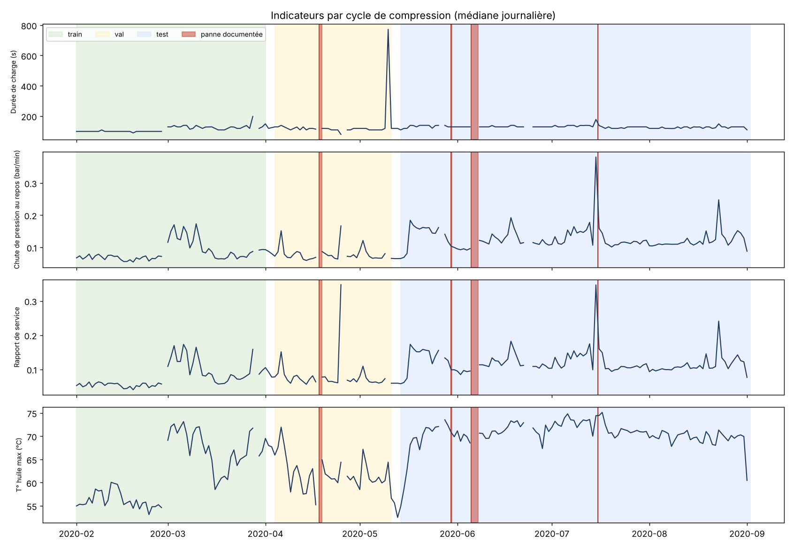
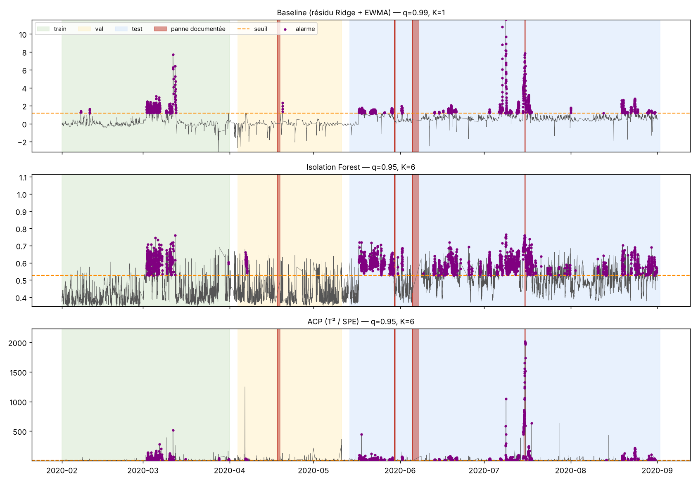
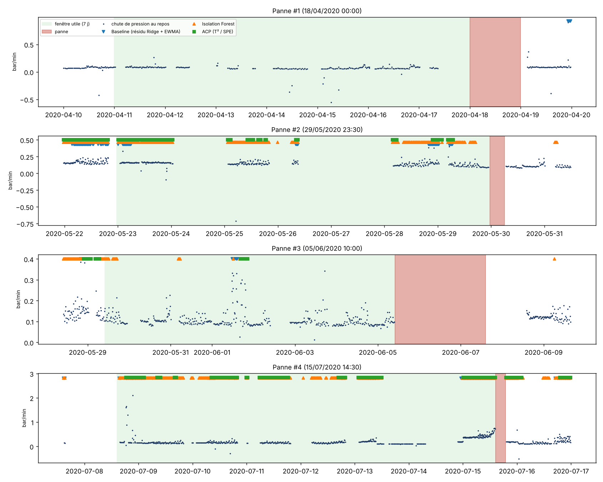

## Résumé

Nous cherchons à alerter l'atelier **avant** une défaillance de l'unité de production d'air (APU) d'un train du métro de Porto, à partir des capteurs publics MetroPT-3. La série est rééchantillonnée **par cycle de compression** ; chaque indicateur est strictement causal. Une baseline imposée (résidu de prévision + seuil + persistance) est comparée à une Isolation Forest et à une ACP (T²/SPE), avec un protocole chronologique train → *gap* → validation → *gap* → test, le test n'étant utilisé qu'une fois. Sur le test (3 pannes documentées), les trois détecteurs alertent avant chaque panne (3/3, IC 95 % [0,29 ; 1]), mais au prix de **5,4 à 7,3 épisodes de fausse alerte par mois**, dus à une dérive durable de la consommation d'air à partir de mi-mai. La baseline offre le meilleur compromis ; l'ablation montre que l'information utile est portée par la **chute de pression des réservoirs au repos**.

## 1. Données et dates de coupure

**Source.** UCI MetroPT-3 (`MetroPT3(AirCompressor).csv`, SHA-256 `db30ccb4…`), téléchargé et vérifié automatiquement par `src/download_data.py`. 7 capteurs analogiques (pressions TP2, TP3, H1, DV, réservoirs ; température d'huile ; courant moteur) et 8 signaux binaires (COMP, DV électrique, tours, MPG, LPS, …).

**Diagnostic de la grille.** La description annonce 1 Hz, mais le fichier public est **décimé à ~10 s** : 1 516 948 lignes du 01/02/2020 au 01/09/2020, pas médian 10 s (99,98 % des pas entre 9 et 13 s), **aucun doublon d'horodatage, aucune valeur manquante codée**. On compte **331 coupures > 60 s** (909 h au total, 160 > 1 h, max 48 h). Ces trous ne sont pas aléatoires : la rame est éteinte (nuit, dépôt, immobilisation). Ils ne sont donc **pas imputés** ; une coupure ferme une « session » et aucune grandeur n'est calculée à travers elle. Régimes : arrêt 55 %, marche à vide 30 %, **charge 16 %**. Pendant les pannes #1 et #3, les capteurs sont figés ou absents (rame immobilisée) : on ne peut détecter qu'en amont.

**Vérité terrain** (rapport de l'exploitant) : quatre fuites d'air, #1 18/04 00:00–23:59 ; #2 29/05 23:30–30/05 06:00 ; #3 05/06 10:00–07/06 14:30 ; #4 15/07 14:30–19:00, avec les heures d'intervention atelier.

**Découpage chronologique (fixé avant toute mesure de performance).**

| Bloc | Période | Cycles | Rôle |
|---|---|---:|---|
| Entraînement | 01/02 → 31/03/2020 | 2 727 | apprendre le « normal » (aucune panne signalée) |
| *gap* | 01/04 → 03/04 | – | 3 j > mémoire des indicateurs (≈ 8 h) |
| Validation | 04/04 → 10/05 | 1 365 | choisir seuil et persistance (panne #1) |
| *gap* | 11/05 → 13/05 | – | |
| Test | 14/05 → 01/09 | 6 447 | **une seule évaluation** (pannes #2, #3, #4) |

## 2. Préparation journalisée et indicateurs causaux

Toutes les étapes sont tracées dans `results/pipeline.log`. Un **cycle de charge** est une séquence continue avec `COMP = 0` (admission ouverte) dans une même session ; on garde les cycles plausibles (20 s à 30 min, gain de pression > 0,3 bar) : 10 751 cycles sur 16 967. L'**instant de décision** d'un cycle est sa *fin* : tout indicateur n'utilise que des mesures antérieures.

| Indicateur | Définition (causale) | Effet attendu d'une fuite |
|---|---|---|
| `duration_s`, `gain_rate` | durée de charge, gain de pression / min | durée ↑, vitesse ↓ |
| `idle_before_s` | repos depuis la fin du cycle **précédent** | ↓ |
| `leak_rate` | (P fin cycle précédent − P début) / repos (bar/min) | **↑** |
| `duty_cycle` | charge / (charge + repos précédent) | ↑ |
| `oil_temp_max`, `current_*` | température d'huile, courant moteur | ↑ |
| tendances | médianes sur les **15 cycles passés** | dérive lente |

**Fuites corrigées par rapport à la première version du dépôt :** `idle_sec` était calculé avec le début du cycle *suivant* puis complété par `bfill()` (information future), et l'alarme était datée au *début* du cycle alors que ses indicateurs ne sont connus qu'à la fin. Désormais, les grandeurs inter-cycles manquantes en début de session (297) restent `NaN` (imputées par la médiane **du train** dans les modèles). Le notebook vérifie automatiquement la causalité : recalculer les indicateurs avec des données tronquées à une date *t* donne exactement les mêmes valeurs pour les cycles terminés avant *t*.

**Période normale.** Le diagnostic interne au train révèle une hausse de consommation du 01 au 11 mars (non signalée) : les journées dont la médiane de `leak_rate` dépasse médiane + 3 MAD des journées d'entraînement sont exclues de la référence (10 jours, règle calculée sur le train seul ; 2 060 cycles de référence).

{width=88%}

## 3. Baseline et modèles plus riches

**Baseline imposée (écrite avant tout modèle).** Une Ridge prévoit `leak_rate` à partir du seul **contexte d'exploitation** (heure en sin/cos, week-end). La température d'huile est volontairement exclue : une fuite la fait monter, elle « expliquerait » l'anomalie. Le résidu standardisé est lissé par une **EWMA causale** (span 10 cycles) ; **seuil** = quantile *q* du score d'entraînement ; **persistance** = *K* cycles consécutifs au-dessus du seuil.

**Modèles plus riches.** (i) *Isolation Forest* (200 arbres, graine 42) sur les 12 indicateurs standardisés ; (ii) *ACP* conservant 90 % de variance, score = max(T², SPE) normalisés par leur médiane d'entraînement. Imputer, scaler, modèles et quantiles sont ajustés **sur le train seul**.

**Choix des hyper-paramètres sur la validation.** Grille *q* ∈ {0,95 ; 0,98 ; 0,99 ; 0,995 ; 0,999} × *K* ∈ {1, 3, 6}. Règle : (1) au plus 2 fausses alertes/mois ; (2) rappel par événement maximal ; (3) à égalité, le réglage **le plus sensible**, car une panne ratée coûte environ 100 fois plus qu'une fausse alerte. Retenu : baseline *q* = 0,99, *K* = 1 (l'EWMA joue déjà le rôle de persistance) ; IF *q* = 0,95, *K* = 6 ; ACP *q* = 0,95, *K* = 6.

## 4. Protocole de validation et métriques

Les métriques sont calculées **par événement** :

* **Détection utile** : au moins une alarme dans `[début − W, début[` avec W = 7 jours (délai pour planifier une rentrée au dépôt). Une alarme pendant la panne est **tardive** et ne compte pas.
* **Avance d'alerte (P-F)** : début de panne − première alarme utile. Elle est donc plafonnée par W.
* **Fausses alertes** : les alarmes espacées de moins de 24 h forment un épisode (une intervention). Un épisode qui démarre hors de `[début − W, maintenance + 24 h]` est une fausse alerte. Le taux est rapporté aux jours sains surveillés (avec données).
* **Incertitude** : IC 95 % de Clopper-Pearson pour le rappel, IC de Poisson exact pour le taux de FA. Nous comparons aussi à un **détecteur aléatoire** qui émettrait des épisodes au même rythme : P(détection) = 1 − exp(−taux × W).

## 5. Résultats (test utilisé une seule fois)

| Détecteur | Pannes détectées avant (test) | IC 95 % rappel | Épisodes FA | FA / mois [IC 95 %] | % cycles en alarme | Rappel du hasard (W = 7 j) |
|---|:-:|:-:|:-:|:-:|:-:|:-:|
| **Baseline** (résidu + EWMA) | **3/3** | [0,29 ; 1] | 14 | **5,4** [3,0 ; 9,1] | **15,7 %** | 0,71 |
| Isolation Forest | 3/3 | [0,29 ; 1] | 19 | 7,3 [4,4 ; 11,4] | 34,5 % | 0,81 |
| ACP (T²/SPE) | 3/3 | [0,29 ; 1] | 15 | 5,8 [3,2 ; 9,5] | 22,0 % | 0,74 |

*Validation* : panne #1 manquée par les trois détecteurs (capteurs figés dès le 17/04 10 h, aucune dérive préalable) ; 0 à 1,1 FA/mois.

**Avance d'alerte.** Pour #2, les trois détecteurs sont déjà en alarme au début de la fenêtre (avance ≥ 167 h, plafonnée) : la consommation d'air au repos double dès le 17/05, soit **12 jours** avant la panne, ce qui place le point P très en amont de F. Pour #3, l'avance est de 94 h (baseline), 168 h (IF) et 90 h (ACP). Pour #4, ≈ 164–167 h, avec un emballement net du `leak_rate` dans les 17 h précédant la panne (0,18 → 0,54 bar/min).

{width=78%}

{width=80%}

**Sensibilité à la fenêtre W (test, configuration figée).** Avec W = 1 j, 2/3 pannes sont détectées (contre 18–22 % pour le hasard) ; avec W = 3 j, 2/3 (hasard 43–52 %) ; avec W ≥ 5 j, 3/3 (hasard 59–97 %). Le gain sur le hasard est donc net à court terme et faible à 7 jours : le taux de fausses alertes rend une fenêtre longue peu informative.

**Ablation (Isolation Forest, chaque variante ré-entraînée et re-réglée sur validation).**

| Variante | Nb var. | Test : détectées | Test : FA/mois |
|---|:-:|:-:|:-:|
| complet | 12 | 3/3 | 7,3 |
| sans durée | 10 | 3/3 | 6,6 |
| sans repos / fuite | 9 | 3/3 | 5,4 |
| sans thermique | 11 | 3/3 | 8,5 |
| sans électrique | 10 | 3/3 | 6,2 |
| sans tendances | 8 | **2/3** (#2 manquée) | **1,9** |
| **seulement repos / fuite** | 3 | **3/3** | **5,0** |

Les trois indicateurs « repos / fuite » suffisent : ils font aussi bien que le modèle complet avec moins de fausses alertes, ce qui confirme l'hypothèse physique. Les tendances glissantes captent la dérive lente de la panne #2 mais génèrent la majorité des fausses alertes estivales. Les groupes thermique et électrique n'apportent rien et suivent surtout la saison.

## 6. Coût des erreurs et décision métier

Hypothèses d'ordre de grandeur : fausse alerte = inspection au dépôt ≈ 150 € ; vraie alerte = réparation planifiée ≈ 200 € ; panne en ligne (immobilisation, remorquage, pénalités) ≈ 20 000 €. Sur le test : sans surveillance, 3 × 20 000 = **60 000 €** ; baseline 14 × 150 + 3 × 200 = **2 700 €** ; ACP 2 850 € ; IF 3 450 €. Avec un rapport de coûts d'environ 130, une panne évitée « paie » environ 130 fausses alertes. Le facteur limitant n'est donc pas financier mais **opérationnel** : à plus d'une fausse alerte par semaine, les équipes risquent d'ignorer les alarmes (fatigue d'alarme). Nous recommandons la **baseline**, la plus simple et la plus sobre en alarmes, avec un réglage revu périodiquement.

## 7. Limites

* **Très peu d'événements** : 1 panne en validation et 3 en test. Les IC sont larges ([0,29 ; 1] pour 3/3) : les résultats sont indicatifs, pas une preuve de performance.
* **Non-stationnarité** : à partir de mi-mai, la consommation d'air au repos reste plus élevée qu'en février (saison, charge passagers, fuite résiduelle après réparation ?). La référence de février-mars est alors dépassée en permanence, d'où l'essentiel des fausses alertes. Pistes (non testées, pour ne pas réutiliser le test) : référence glissante décalée de plusieurs jours, recalibrage après chaque maintenance, variables exogènes (température extérieure, charge).
* **Validation peu informative** : la panne #1 n'a pas de signature exploitable, si bien que le choix du seuil repose surtout sur le budget de fausses alertes.
* **Fenêtre utile W = 7 j** : c'est un choix métier ; l'avance mesurée est plafonnée par W. Le tableau de sensibilité expose ce choix.
* **Données décimées à 10 s** : les transitoires de démarrage (≈ 1–2 s) ne sont pas observables ; les coûts sont des hypothèses à valider avec l'exploitant.
* **Hors périmètre** : nous détectons des anomalies sans prédire de durée de vie restante, et les signaux binaires (LPS, MPG) ne sont pas exploités comme variables d'entrée.

## Reproductibilité

`bash run_all.sh` crée l'environnement figé (`requirements.txt`), télécharge et vérifie les données, exécute le pipeline (graines fixées à 42) et ré-exécute le notebook. Tous les chiffres de ce rapport proviennent de `results/` (`metriques_par_split.csv`, `detection_par_panne.csv`, `ablation.csv`, `sensibilite_fenetre.csv`, `couts_test.csv`).

*Références :* Veloso et al., *The MetroPT dataset for predictive maintenance*, Scientific Data 9:764 (2022) ; Davari et al., IEEE DSAA 2021.
